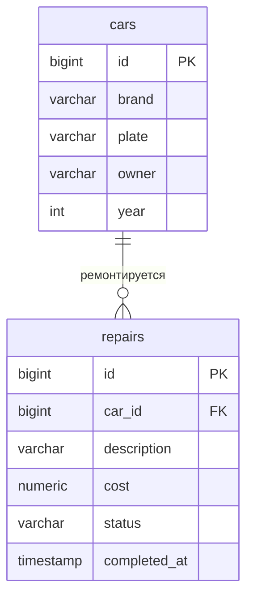

# Автосервис

Тема №20: **Автосервис**. Сервис учёта автомобилей клиентов и их ремонта для администраторов и мастеров автосервиса.

|                          |                                                                                   |
| ------------------------ | --------------------------------------------------------------------------------- |
| Главная сущность         | Автомобиль                                                                        |
| Связанная сущность (1:N) | Ремонт                                                                            |
| Фишка                    | Статус ремонта меняется строго по порядку (принят, в работе, готов), выручка по месяцам |
| Стек                     | Python 3.10+, FastAPI, данные в памяти (база данных появится в лабе 2)            |

## Как запустить

```
git clone https://github.com/<ваш-логин>/<имя-репозитория>.git
cd <имя-репозитория>
python -m venv .venv


macOS 
source .venv/bin/activate

pip install -r requirements.txt
uvicorn main:app --port 8000
```

Сервис работает на `http://localhost:8000`. Запросы для демонстрации лежат в `requests.http`. Swagger UI: `http://localhost:8000/docs`.

## Эндпоинты

| Метод  | Путь               | Что делает                                    | Ответ                               |
| ------ | ------------------ | --------------------------------------------- | ----------------------------------- |
| GET    | `/health`          | Проверка, что сервис жив                      | 200 `{"status":"ok"}`               |
| POST   | `/api/cars`        | Создать автомобиль                            | 201 и объект с `id`; 400 при ошибке |
| GET    | `/api/cars`        | Список (`limit`, `offset`, фильтры `brand`, `plate`, `owner`, `year`) | 200; 400 |
| GET    | `/api/cars/{id}`   | Получить один автомобиль                      | 200; 404                            |
| PUT    | `/api/cars/{id}`   | Заменить автомобиль целиком                   | 200; 400; 404                       |
| PATCH  | `/api/cars/{id}`   | Изменить отдельные поля                       | 200; 400; 404                       |
| DELETE | `/api/cars/{id}`   | Удалить                                       | 204; 404                            |

Ошибки валидации приходят в формате `{"error": "текст", "field": "имя поля"}` с кодом 400.

Эндпоинты связанной сущности добавятся в лабе 2:

| Метод  | Путь                                   | Что делает                         | Ответ              |
| ------ | -------------------------------------- | ---------------------------------- | ------------------ |
| POST   | `/api/cars/{id}/repairs`               | Добавить ремонт автомобилю         | 201; 400; 404      |
| GET    | `/api/cars/{id}/repairs`               | Список ремонтов автомобиля         | 200; 404           |
| PATCH  | `/api/cars/{id}/repairs/{rid}/status`  | Сменить статус ремонта по порядку  | 200; 400; 404; 409 |
| GET    | `/api/stats/revenue`                   | Выручка по месяцам                 | 200                |

## ER-диаграмма



## Интерфейс

Документация API: `http://localhost:8000/docs` (Swagger UI).
